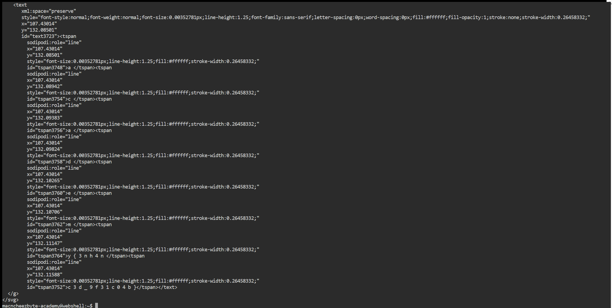

# Enchance!

Challenge Link: https://learn.cylabacademy.org/learning-paths/18/165

- Learning Path: `The Beginner's Guide to the Challenge Library`
- Name: `Enchance!`
- Category: `General Skills`
- Difficulty: `Medium`

## Writeup

I used the `wget` command to download the image. 

I was curious in the content of the file, so I ran `cat drawing.flag.svg`



While I was examining the contents of the file, I noticed two particular lines located in the last 6 lines:

`id="tspan3764">y { 3 n h 4 n </tspan><tspan`
...\
`id="tspan3752">c 3 d _ 9 f 3 1 c 0 4 b }</tspan></text>`

These are fragments of the flag.

## Flag

```
academy{3nh4nc3d_9f31c04b}
```
