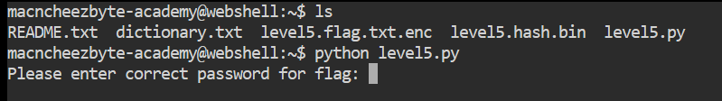
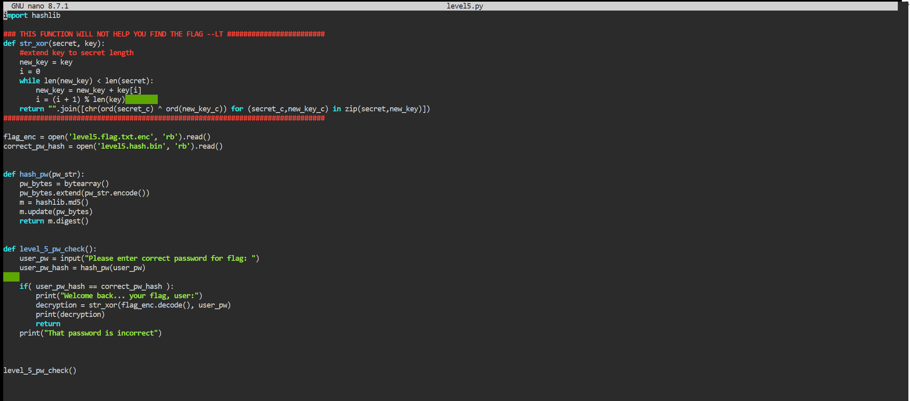
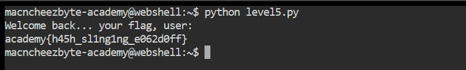

# PW Crack 5

Challenge Link: https://learn.cylabacademy.org/learning-paths/18/164

- Learning Path: `The Beginner's Guide to the Challenge Library`
- Name: `PW Crack 5`
- Category: `General Skills`
- Difficulty: `Medium`

## Writeup

I first downloaded all the files using `wget`. 

Initially I was kind of daunted by the amount of words in the description, but my first instinct was to execute the python file.



The program prompts for the password, so we need to find what that is. The description states that the `dictionary.txt` file contains all the possible passwords. When running `cat dictionary.txt`, I was able to see that it's a *very* long list of possible passwords; it would be very tedious to manually brute force this.

I then ran `nano level5.py` to examine the code. 



After reading the code, I understood a few things:
- `level5.hash.bin` contains the hash of the correct password
- when the user inputs a password, its hash is compared to the correct hash
- the flag is encrypted in the file `level5.flag.txt.enc` 
- the correct password is the key to decrypting the flag

Initially, as I was reading the if-statement, I thought to just changing the line
```python
if( user_pw_hash == correct_pw_hash ):
```
to 
```python
if( true ):
```
to force the code in the block to run regardless if the password entered is true. However, by examining this line if the if-statement's block:
```python
decryption = str_xor(flag_enc.decode(), user_pw)
```
The correct password is needed. The second parameter in the str_xor function is the key. The correct password is the key for decryption, and without the key, the flag cannot be properly decrypted.

So I thought of another way of modifying the code: I would add a loop that iterates through every possible password in `dictionary.txt`, hash it, and compare it to the correct hash. If both hashes match, the correct password has been found. 

In order to give myself write permissions on `level5.py`, I ran this command:
```bash
chmod +w level5.py
```

Then I created a text file by running `nano`, then I copied and pasted `level5.py`'s code into it, and then added my changes:
```python
import hashlib

with open('dictionary.txt', 'r') as file:
  pos_pw_list = file.read().splitlines()

### THIS FUNCTION WILL NOT HELP YOU FIND THE FLAG --LT ########################
def str_xor(secret, key):
    #extend key to secret length
    new_key = key
    i = 0
    while len(new_key) < len(secret):
        new_key = new_key + key[i]
        i = (i + 1) % len(key)        
    return "".join([chr(ord(secret_c) ^ ord(new_key_c)) for (secret_c,new_key_c) in zip(secret,new_key)])
###############################################################################

flag_enc = open('level5.flag.txt.enc', 'rb').read()
correct_pw_hash = open('level5.hash.bin', 'rb').read()


def hash_pw(pw_str):
    pw_bytes = bytearray()
    pw_bytes.extend(pw_str.encode())
    m = hashlib.md5()
    m.update(pw_bytes)
    return m.digest()


def level_5_pw_check():
    user_pw = ""
    user_pw_hash = ""

    for password in pos_pw_list:
        user_pw_hash = hash_pw(password)
        if user_pw_hash == correct_pw_hash:
            user_pw = password
            break
    
    if( user_pw_hash == correct_pw_hash ):
        print("Welcome back... your flag, user:")
        decryption = str_xor(flag_enc.decode(), user_pw)
        print(decryption)
        return
    print("That password is incorrect")


level_5_pw_check()
```
The only things I added was the for loop, and the first two lines in the beginning of the script. I then overwrote this to `level5.py`.

I then ran `level5.py`, and successful received the flag.



## Flag

```
academy{h45h_sl1ng1ng_e062d0ff}
```

